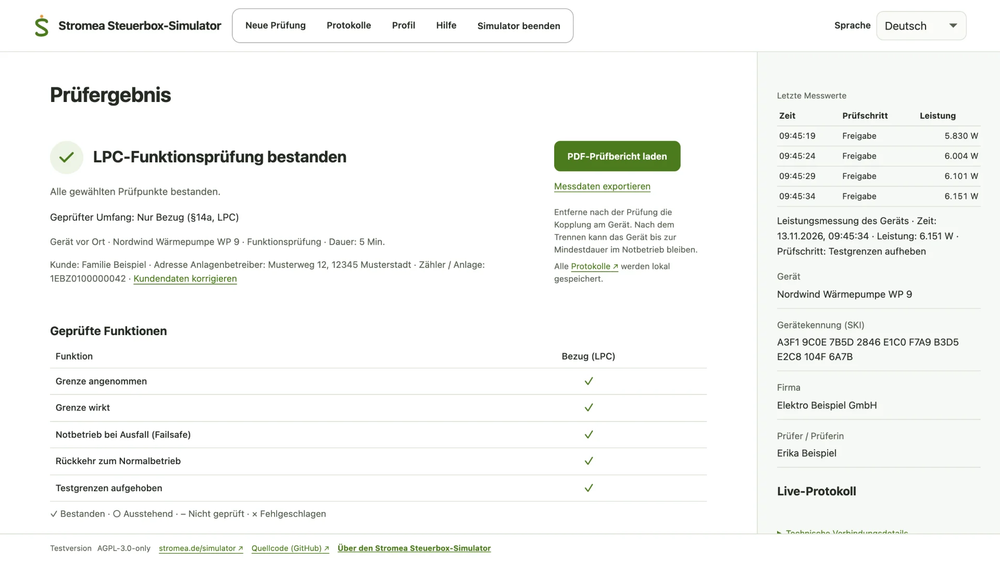
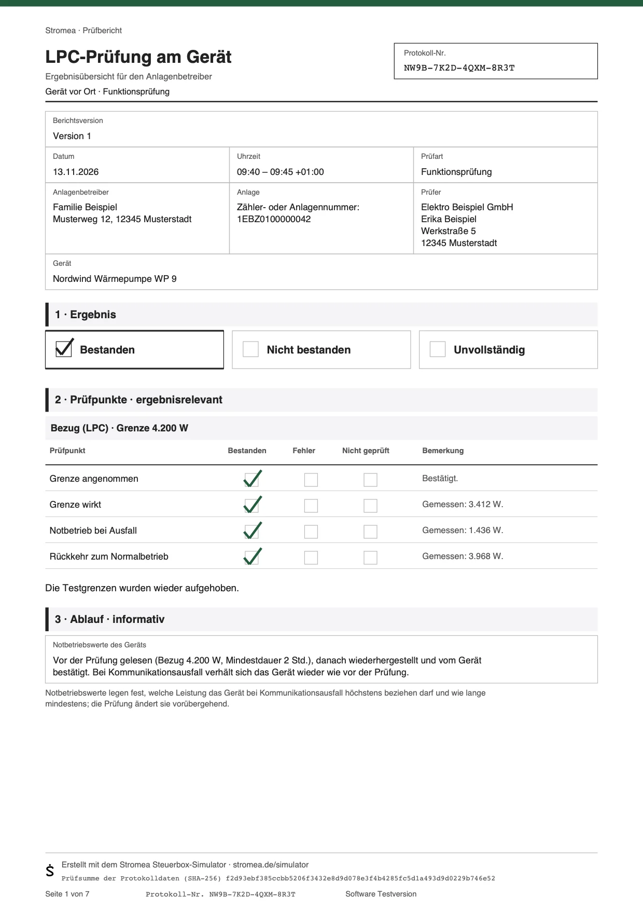

[English](README.md) · **Deutsch**

# Stromea Steuerbox-Simulator

**Steuerbox-Simulator für EEBUS**

[](https://github.com/stromea-de/steuerbox-simulator/releases/tag/v1.0.1)
[](LICENSE)

## Was es ist

Der Stromea Steuerbox-Simulator bildet die Steuerbox (Energy Guard) des Netzbetreibers in Software per EEBUS (SHIP über TLS/WebSocket und SPINE) nach. Er prüft im lokalen Netz geführt:

- **LPC** — Bezugsbegrenzung nach §14a EnWG
- **LPP** — Einspeisebegrenzung nach §9 EEG
- **MPC** — Leistungsmesswerte des Geräts
- **Heartbeat & Failsafe** — Überwachung der Lebenszeichen, Notbetrieb bei Signalausfall und Rückstellung der ursprünglichen Failsafe-Werte

Am Ende entsteht ein zweistufiger deutscher **PDF-Prüfbericht** sowie ein **JSON**-Messdatenexport. Kernprüfung und Berichtserstellung laufen lokal auf deinem Rechner (`127.0.0.1`), ohne Cloud-Dienst oder Benutzerkonto. Die Anwendung enthält keine eigene Telemetrie. Optionales Browserdiktat kann nach deiner Zustimmung Audio an den Spracherkennungsdienst des Browsers senden und eine Internetverbindung benötigen.

> **Kein Zertifizierungsanspruch:** Dies ist eine Software-Simulation für Funktionsprüfungen. Sie ist keine Steuerbox-Hardware und ersetzt keine Konformitätsprüfung.

## Für wen

- **Elektrofachbetriebe:** Vor-Ort-Funktionsprüfung bei der Inbetriebnahme, bevor die Steuerbox des Netzbetreibers montiert ist.
- **Stadtwerke sowie Netz- und Messstellenbetreiber:** Prüfung steuerbarer Anlagen und ihrer EEBUS-Steuerung im Feld.
- **Hersteller steuerbarer Verbrauchseinrichtungen und Energiemanagementsysteme:** Interoperabilitätstests für Wärmepumpen, Wallboxen, Speicher, Wechselrichter und EMS.

## Vorschau & Prüfbericht



Jede Prüfung erzeugt einen deutschen PDF-Bericht samt JSON-Messdaten:

- **Seite 1 (Betreiberübersicht):** Gesamtergebnis (*Bestanden*, *Unvollständig* oder *Nicht bestanden*), Zusammenfassung der Kernpunkte, Gerätedaten, Zeitstempel und freiwillige Unterschriftsfelder.
- **Ab Seite 2 (Technischer Anhang):** Zeitgestempelte Einzelschritte, Sollwerte, Gerätequittungen und gemessene Leistungswerte. Der Fuß enthält die Protokoll-Nr. und die SHA-256-Prüfsumme der exakten JSON-Exportdatei (keine digitale Signatur).



## Download & Installation

Aktuelle Version: **1.0.1** ([Release v1.0.1](https://github.com/stromea-de/steuerbox-simulator/releases/tag/v1.0.1), 19.11.2026).

| Plattform | Architektur | Download | Start |
|---|---|---|---|
| **macOS** (Apple Silicon) | arm64 | [stromea-steuerbox-simulator_1.0.1_darwin_arm64.tar.gz](https://github.com/stromea-de/steuerbox-simulator/releases/download/v1.0.1/stromea-steuerbox-simulator_1.0.1_darwin_arm64.tar.gz) | Entpacken und `./stromea-steuerbox-simulator` starten |
| **macOS** (Intel) | amd64 | [stromea-steuerbox-simulator_1.0.1_darwin_amd64.tar.gz](https://github.com/stromea-de/steuerbox-simulator/releases/download/v1.0.1/stromea-steuerbox-simulator_1.0.1_darwin_amd64.tar.gz) | Entpacken und `./stromea-steuerbox-simulator` starten |
| **Windows** | amd64 (x64) | [stromea-steuerbox-simulator_1.0.1_windows_amd64.zip](https://github.com/stromea-de/steuerbox-simulator/releases/download/v1.0.1/stromea-steuerbox-simulator_1.0.1_windows_amd64.zip) | Entpacken und `stromea-steuerbox-simulator.exe` doppelklicken |
| **Windows** | arm64 | [stromea-steuerbox-simulator_1.0.1_windows_arm64.zip](https://github.com/stromea-de/steuerbox-simulator/releases/download/v1.0.1/stromea-steuerbox-simulator_1.0.1_windows_arm64.zip) | Entpacken und `stromea-steuerbox-simulator.exe` doppelklicken |
| **Linux** | amd64 (x86_64) | [TAR.GZ](https://github.com/stromea-de/steuerbox-simulator/releases/download/v1.0.1/stromea-steuerbox-simulator_1.0.1_linux_amd64.tar.gz) · [DEB](https://github.com/stromea-de/steuerbox-simulator/releases/download/v1.0.1/stromea-steuerbox-simulator_1.0.1_linux_amd64.deb) · [RPM](https://github.com/stromea-de/steuerbox-simulator/releases/download/v1.0.1/stromea-steuerbox-simulator_1.0.1_linux_amd64.rpm) | `./stromea-steuerbox-simulator serve` oder Paketinstallation |
| **Linux** | arm64 | [TAR.GZ](https://github.com/stromea-de/steuerbox-simulator/releases/download/v1.0.1/stromea-steuerbox-simulator_1.0.1_linux_arm64.tar.gz) · [DEB](https://github.com/stromea-de/steuerbox-simulator/releases/download/v1.0.1/stromea-steuerbox-simulator_1.0.1_linux_arm64.deb) · [RPM](https://github.com/stromea-de/steuerbox-simulator/releases/download/v1.0.1/stromea-steuerbox-simulator_1.0.1_linux_arm64.rpm) | `./stromea-steuerbox-simulator serve` oder Paketinstallation |

Ebenfalls im Release enthalten: [stromea-steuerbox-simulator_1.0.1_source.tar.gz](https://github.com/stromea-de/steuerbox-simulator/releases/download/v1.0.1/stromea-steuerbox-simulator_1.0.1_source.tar.gz) und [SHA256SUMS](https://github.com/stromea-de/steuerbox-simulator/releases/download/v1.0.1/SHA256SUMS).

### Systemvoraussetzungen

- Passendes 64-Bit-Betriebssystem: **macOS 13 Ventura+**, **Windows 10+** bzw. **Windows Server 2016+** oder **Linux** (amd64/arm64, Go-Kernelbasis **3.2+**, ohne CGO-/glibc-Abhängigkeit). Keine 32-Bit- oder 32-Bit-Raspberry-Pi-OS-Unterstützung. Die tatsächliche Laufzeitabnahme auf allen Mindestversionen sowie DEB-/RPM-Zielsystemtests stehen noch aus.
- Ein aktueller Webbrowser und ein beschreibbarer Benutzer-Konfigurationsordner.
- Fertige Binaries benötigen weder Go noch Python oder Xcode (`gh` CLI wird nur für die Attestation-Prüfung benötigt).

### Start & Betriebssystemwarnungen

- **macOS:** `./stromea-steuerbox-simulator` ohne Argumente startet Browser und Menüleiste; `./stromea-steuerbox-simulator serve` bleibt im Terminal. Die Downloads haben **keine Developer-ID-Signatur und sind nicht notarisiert**. Gatekeeper kann Quarantäne-Downloads wegen eines nicht verifizierten Entwicklers sperren. Erst nach erfolgreicher Herkunfts- und Hashprüfung: im Finder Rechtsklick → **Öffnen** (ggf. unter **Datenschutz & Sicherheit** zulassen) oder am entpackten Binary `xattr -d com.apple.quarantine ./stromea-steuerbox-simulator` ausführen. Dies entfernt nur die Quarantäne und ersetzt keine Signatur oder Notarisierung.
- **Windows:** Das Release-Binary ist ein GUI-Build (`-H=windowsgui`); vorgesehen ist der Doppelklick auf `stromea-steuerbox-simulator.exe` für Browser und Infobereich. `.\stromea-steuerbox-simulator.exe serve` kann den Server starten, garantiert aber weder sichtbare Konsolenausgabe noch Terminal-Vordergrund-/Strg+C-Verhalten. Für Terminalbetrieb einen Konsolenbuild aus dem Quellcode verwenden, siehe unten. Es gibt **keine Authenticode-Signatur**; SmartScreen kann warnen oder blockieren. Prüfe Herkunft und Hash vor dem Start und beachte die Sicherheitsvorgaben deines Betriebs.
- **Linux:** Archiv entpacken und `./stromea-steuerbox-simulator serve` starten, oder verifiziertes Paket installieren (`sudo apt install ./stromea-steuerbox-simulator_1.0.1_linux_amd64.deb` bzw. `sudo dnf install ./stromea-steuerbox-simulator_1.0.1_linux_amd64.rpm`, oder `arm64`) und `stromea-steuerbox-simulator serve` ausführen. Angezeigte URL im Browser öffnen.

### Netzwerk, Port & Datenordner

- **Adresse der Weboberfläche:** Ausschließlich Loopback `http://127.0.0.1:33287` (anderer Loopback-Port per `serve --listen 127.0.0.1:33288`). Für die UI ist keine eingehende LAN-Firewallfreigabe nötig.
- **Gerätekommunikation:** Der Übungsmodus läuft rein lokal auf Loopback. Der Gerätebetrieb vor Ort erfordert ausdrückliche Freigabe und SKI-Bestätigung; er nutzt mDNS UDP `5353` (`_ship._tcp.local.`) und ausgehendes SHIP/TLS an den angekündigten bzw. manuell eingetragenen Geräte-TCP-Port (**4711 ist kein universeller Geräteport**).
- **Datenordner (`os.UserConfigDir()/stromea-steuerbox-simulator/`, abweichend per `--state`):**
  - macOS: `~/Library/Application Support/stromea-steuerbox-simulator/`
  - Windows: `%AppData%\stromea-steuerbox-simulator\`
  - Linux: `${XDG_CONFIG_HOME:-$HOME/.config}/stromea-steuerbox-simulator/`
  - Enthält gespeicherte Berichte (`reports/`), Identitäten (`energyguard/identity.pem`, `simulator/identity.pem`), Kopplungsdaten (`trust.json`) — private Schlüssel nicht teilen — sowie Desktop-Logs (`logs/simulator.log`, Rotation auf eine `.previous`-Datei ab 5 MiB). Das Löschen portabler Binaries entfernt die Benutzerdaten nicht.

## Downloads prüfen & Sicherheit

Alle zwölf Release-Dateien (die elf Downloads und `SHA256SUMS`) tragen GitHub Artifact Attestations. Es gibt keine minisign-Signatur, keine `release.pub` und kein cosign-Bundle.

Prüfe vor dem Entpacken oder Installieren sowohl `SHA256SUMS` als auch deinen gewählten Download mit einer separat bereitgestellten [GitHub CLI](https://cli.github.com/) und vergleiche danach die SHA-256-Prüfsumme:

```sh
gh attestation verify SHA256SUMS --repo stromea-de/steuerbox-simulator
gh attestation verify stromea-steuerbox-simulator_1.0.1_darwin_arm64.tar.gz --repo stromea-de/steuerbox-simulator
# Nur wenn alle elf Downloads vorliegen:
shasum -a 256 -c SHA256SUMS
# Bei nur einem Download genau diesen Eintrag prüfen:
grep '  stromea-steuerbox-simulator_1.0.1_darwin_arm64.tar.gz$' SHA256SUMS | shasum -a 256 -c -
```

Unter Linux kannst du statt `shasum -a 256` auch `sha256sum` verwenden. Unter Windows prüfst du beide Attestations (`SHA256SUMS` und die ZIP) mit `gh attestation verify` und vergleichst anschließend `Get-FileHash .\stromea-steuerbox-simulator_1.0.1_windows_amd64.zip -Algorithm SHA256` mit dem Eintrag in `SHA256SUMS`. Bei jedem Prüffehler abbrechen und nicht starten.

Sicherheitsmeldungen (`kontakt@stromea.de`) und lokale Sicherheitsprinzipien stehen in [SECURITY.md](SECURITY.md), Betriebs- und Nachweisgrenzen in [docs/SICHERHEIT.md](docs/SICHERHEIT.md).

## Schnellstart

### 1. Übungsmodus (ohne Hardware)

1. Simulator starten und `http://127.0.0.1:33287` öffnen.
2. **Übungsmodus** wählen und auf **Übungsmodus starten** klicken. Die Verbindung läuft über Loopback zu einem eingebauten virtuellen Testgerät mit verkürzten Wartezeiten (belegt keine reale Hardware und keine normativen 2-h-Failsafe-Zeiten).
3. Auf **Prüfung starten** klicken und am Ende den deutschen PDF-Prüfbericht sowie die JSON-Messdaten herunterladen.

### 2. Gerät vor Ort

Reale Anlagen nur nach ausdrücklicher Freigabe durch den Betreiber prüfen.

1. **Gerät vor Ort** wählen, Netzwerkadapter festlegen und auf **Im Netzwerk suchen** klicken (alternativ QR-Code einlesen oder IP:Port und SKI manuell eingeben).
2. Gerätekennung (SKI) direkt am Gerät vergleichen, die Simulator-Kennung am Gerät freigeben und verbinden.
3. Testwerte prüfen (Vorgaben: **4.200 W** Bezug LPC, **1.000 W** Einspeisung LPP ohne Messwert bzw. 50 % einer frischen Einspeisemessung, **500 W** Notbetrieb/Failsafe, **50 W** Toleranz — Eignung für den Aufbau prüfen; dies sind Simulator-Testwerte und keine pauschalen gesetzlichen Vorgaben).
4. **Funktionsprüfung** (prüft den Eintritt in den Notbetrieb bis 120 s je Richtung; Mindestdauer bleibt ungeprüft) oder **Langzeitprüfung** (wartet die eingestellte Mindestdauer von 2–24 h je Richtung ab) wählen.
5. Browser bis zum Abschluss geöffnet lassen. Ursprüngliche Notbetriebs-Werte werden vor Änderungen gelesen und am Ende einzeln zurückgestellt und frisch rückgelesen (ohne lesbare Ursprungswerte wird nichts überschrieben). Bleibt die Aufhebung oder Rückstellung unbestätigt, den Gerätezustand direkt am Gerät kontrollieren.

## Getestete Geräte

| Hersteller | Gerät | Schnittstelle | Status |
|---|---|---|---|
| **Stromea** ([stromea.de](https://stromea.de)) | Stromea-Firmware auf Finder OPTA Advanced / Arduino Opta WiFi – Energiemanagement mit App und Stromea AI | EEBUS (LPC, LPP, MPC) | Interoperabilitätstest mit dem Simulator läuft (Firmwarestand noch nicht dokumentiert); vollständiger Prüfbericht steht noch aus. |

> Ergebnisse mit echten Geräten liegen bislang nur begrenzt vor; jeder Bericht nennt genau, was geprüft wurde. Weiteres Gerät getestet? [Kompatibilität über unsere Vorlage melden](https://github.com/stromea-de/steuerbox-simulator/issues/new?template=geraetekomp_melden.md).

## Sprachen

- **Weboberfläche:** Sieben Sprachen — Deutsch, Englisch, Polnisch, Russisch, Ukrainisch, Türkisch und Rumänisch. Die Übersetzungen sind KI-geprüft, ohne Muttersprachler-Lektorat.
- **PDF-Prüfbericht:** Erscheint immer auf Deutsch.

## CLI & Aus dem Quellcode bauen

```sh
# Probelauf im Übungsmodus mit PDF-Ausgabe
./stromea-steuerbox-simulator demo --betrieb 'Elektro Muster' --pruefer 'Alex Muster' --pdf Bericht.pdf

# Weboberfläche auf anderem Loopback-Port starten (Standard: 127.0.0.1:33287)
./stromea-steuerbox-simulator serve --listen 127.0.0.1:33288

# Lokale Simulator-Identitäten (SKI) oder Version anzeigen
./stromea-steuerbox-simulator identity
./stromea-steuerbox-simulator --version
```

Für den Bau aus dem Quellcode ist **Go 1.26.0 oder neuer** erforderlich (die Release-Toolchain ist mit **Go 1.27.3** geprüft; Desktop-Builds unter macOS nutzen CGO und Xcode Command Line Tools, Windows und Linux bauen mit `CGO_ENABLED=0`):

```sh
git clone https://github.com/stromea-de/steuerbox-simulator.git
cd steuerbox-simulator
go run ./cmd/steuerbox-simulator serve
```

Für Windows-Terminalbetrieb aus dem ausgecheckten Quellcode in PowerShell **ohne `-H=windowsgui`** bauen:

```powershell
$env:CGO_ENABLED = '0'
go build -trimpath -buildvcs=false -o stromea-steuerbox-simulator-console.exe ./cmd/steuerbox-simulator
.\stromea-steuerbox-simulator-console.exe serve
```

Die obigen CLI-Beispiele gelten für konsolenfähige Builds; das Windows-GUI-Release garantiert auch bei `--version` oder Fehlern keine sichtbare Konsolenausgabe. Eine native Windows-Abnahme des Konsolenverhaltens steht noch aus.

Weitere Dokumentation: [Entwicklung](docs/ENTWICKLUNG.md) · [Verteilung & Prüfung](docs/VERTEILUNG.md) · [Release Notes 1.0.1](docs/RELEASE_NOTES_1.0.1.md) · [Changelog](CHANGELOG.md) · [Mitmachen](CONTRIBUTING.md)

## Lizenz & Markenhinweis

Dieses Projekt steht unter der **GNU Affero General Public License v3.0** ([AGPL-3.0-only](LICENSE)), ohne kommerzielles Dual-Licensing. Fremdabhängigkeiten und vollständige Hinweise stehen in [docs/LIZENZEN.md](docs/LIZENZEN.md).

Die EEBUS-Wort-/Bildmarke ist eine eingetragene Marke der EEBus Initiative e.V. EEBUS bezeichnet hier den unterstützten Kommunikationsstandard. Der Stromea Steuerbox-Simulator ist ein unabhängiges Open-Source-Projekt und wird weder von der EEBus Initiative e.V. noch von der EEBUService GmbH herausgegeben oder zertifiziert. Er ist keine Steuerbox-Hardware und ersetzt keine Konformitätsprüfung.

© 2026 Dr. Lucas Spohn (Stromea)
