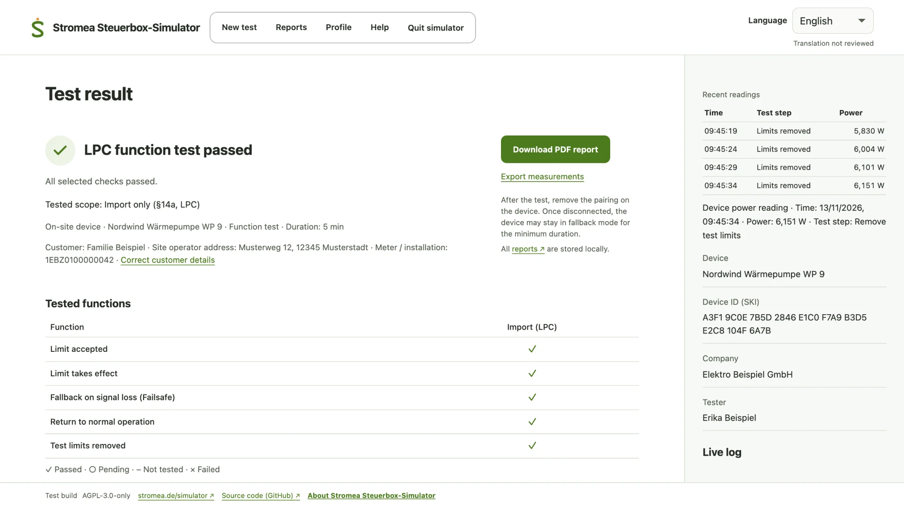
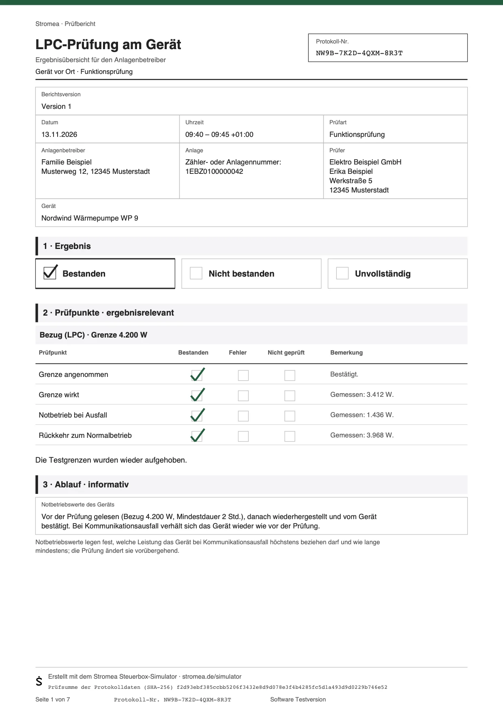

**English** · [Deutsch](README.de.md)

# Stromea Steuerbox-Simulator

**Grid control box simulator for EEBUS**

[](https://github.com/stromea-de/steuerbox-simulator/releases/tag/v1.0.0)
[](LICENSE)

## What it is

The Stromea Steuerbox-Simulator simulates a grid operator's control box (Energy Guard) in software via EEBUS (SHIP over TLS/WebSocket and SPINE). It runs guided functional checks for:

- **LPC** — grid import power limitation (§14a EnWG)
- **LPP** — feed-in power limitation (§9 EEG)
- **MPC** — device power measurement feedback
- **Heartbeat & Failsafe** — connection monitoring, fallback behavior on signal loss, and restoration of previous failsafe settings

After each run, it produces a two-part German **PDF test report** and a **JSON** measurement export. Core testing and report generation run locally on your computer (`127.0.0.1`), without a cloud service or user account. The application has no telemetry of its own. Optional browser dictation can, after your consent, send audio to the browser's speech recognition service and require an internet connection.

> **No certification claim:** This is a software simulation for functional testing. It is not control box hardware and does not replace a conformity assessment.

## Who it is for

- **Electrical contractors & installers:** Commissioning checks on site before a physical utility control box is installed.
- **Municipal utilities, grid & metering point operators:** Field verification of controllable installations and EEBUS control behavior.
- **Device & EMS manufacturers:** Interoperability checks for controllable loads, inverters, storage systems, and energy management systems (EMS).

## Preview & Test Report



Every test generates a German PDF report and matching JSON measurement data:

- **Page 1 (Operator overview):** Overall result (*Bestanden*, *Unvollständig* (Incomplete), or *Nicht bestanden*), core check summary, device details, timestamp, and optional signature fields.
- **Page 2+ (Technical appendix):** Time-stamped steps, setpoints, device acknowledgements, and measured power values. The footer includes the report ID and the SHA-256 hash of the exported JSON data (not a digital signature).



## Download & Installation

Current version: **1.0.0** ([Release v1.0.0](https://github.com/stromea-de/steuerbox-simulator/releases/tag/v1.0.0), 2026-11-17).

| Platform | Architecture | Download | Launch |
|---|---|---|---|
| **macOS** (Apple Silicon) | arm64 | [stromea-steuerbox-simulator_1.0.0_darwin_arm64.tar.gz](https://github.com/stromea-de/steuerbox-simulator/releases/download/v1.0.0/stromea-steuerbox-simulator_1.0.0_darwin_arm64.tar.gz) | Extract and run `./stromea-steuerbox-simulator` |
| **macOS** (Intel) | amd64 | [stromea-steuerbox-simulator_1.0.0_darwin_amd64.tar.gz](https://github.com/stromea-de/steuerbox-simulator/releases/download/v1.0.0/stromea-steuerbox-simulator_1.0.0_darwin_amd64.tar.gz) | Extract and run `./stromea-steuerbox-simulator` |
| **Windows** | amd64 (x64) | [stromea-steuerbox-simulator_1.0.0_windows_amd64.zip](https://github.com/stromea-de/steuerbox-simulator/releases/download/v1.0.0/stromea-steuerbox-simulator_1.0.0_windows_amd64.zip) | Extract and double-click `stromea-steuerbox-simulator.exe` |
| **Windows** | arm64 | [stromea-steuerbox-simulator_1.0.0_windows_arm64.zip](https://github.com/stromea-de/steuerbox-simulator/releases/download/v1.0.0/stromea-steuerbox-simulator_1.0.0_windows_arm64.zip) | Extract and double-click `stromea-steuerbox-simulator.exe` |
| **Linux** | amd64 (x86_64) | [TAR.GZ](https://github.com/stromea-de/steuerbox-simulator/releases/download/v1.0.0/stromea-steuerbox-simulator_1.0.0_linux_amd64.tar.gz) · [DEB](https://github.com/stromea-de/steuerbox-simulator/releases/download/v1.0.0/stromea-steuerbox-simulator_1.0.0_linux_amd64.deb) · [RPM](https://github.com/stromea-de/steuerbox-simulator/releases/download/v1.0.0/stromea-steuerbox-simulator_1.0.0_linux_amd64.rpm) | `./stromea-steuerbox-simulator serve` or package install |
| **Linux** | arm64 | [TAR.GZ](https://github.com/stromea-de/steuerbox-simulator/releases/download/v1.0.0/stromea-steuerbox-simulator_1.0.0_linux_arm64.tar.gz) · [DEB](https://github.com/stromea-de/steuerbox-simulator/releases/download/v1.0.0/stromea-steuerbox-simulator_1.0.0_linux_arm64.deb) · [RPM](https://github.com/stromea-de/steuerbox-simulator/releases/download/v1.0.0/stromea-steuerbox-simulator_1.0.0_linux_arm64.rpm) | `./stromea-steuerbox-simulator serve` or package install |

Also published in the release: [stromea-steuerbox-simulator_1.0.0_source.tar.gz](https://github.com/stromea-de/steuerbox-simulator/releases/download/v1.0.0/stromea-steuerbox-simulator_1.0.0_source.tar.gz) and [SHA256SUMS](https://github.com/stromea-de/steuerbox-simulator/releases/download/v1.0.0/SHA256SUMS).

### System requirements

- Matching 64-bit operating system: **macOS 13 Ventura+**, **Windows 10+** / **Windows Server 2016+**, or **Linux** (amd64/arm64, Go kernel baseline **3.2+**, no CGO or glibc dependency). No 32-bit or 32-bit Raspberry Pi OS support. Actual runtime verification across all minimum OS versions and target-system DEB/RPM package installations is still pending.
- A current web browser and a writable user configuration directory.
- Prebuilt binaries require no Go, Python, or Xcode installation (`gh` CLI is only required to verify attestations).

### Startup & OS security warnings

- **macOS:** Run `./stromea-steuerbox-simulator` without arguments to open the browser and menu bar icon, or `./stromea-steuerbox-simulator serve` in a terminal. Releases have **no Apple Developer ID signature and are not notarized**. Gatekeeper may block quarantined downloads as an unverified developer. Only after verifying provenance and checksum: use Finder → right-click → **Open** (and allow in **Privacy & Security** if needed), or run `xattr -d com.apple.quarantine ./stromea-steuerbox-simulator` on the extracted binary. Removing quarantine does not add a signature or notarization.
- **Windows:** The release binary is a GUI build (`-H=windowsgui`); double-click `stromea-steuerbox-simulator.exe` to open the browser and system tray icon. Calling `.\stromea-steuerbox-simulator.exe serve` can start the server, but console output and terminal foreground/Ctrl+C behavior are not guaranteed. For terminal use, build a console binary from source as shown below. Releases have **no Authenticode signature**; SmartScreen may warn or block execution. Verify provenance and checksum first and follow your organization's security policy.
- **Linux:** Extract the archive and run `./stromea-steuerbox-simulator serve`, or install the verified package (`sudo apt install ./stromea-steuerbox-simulator_1.0.0_linux_amd64.deb` or `sudo dnf install ./stromea-steuerbox-simulator_1.0.0_linux_amd64.rpm`, or `arm64`) and run `stromea-steuerbox-simulator serve`. Open the printed URL in your browser.

### Network, port & data directory

- **Web UI address:** Strictly loopback `http://127.0.0.1:33287` (`serve --listen 127.0.0.1:33288` sets a different loopback port). No incoming LAN firewall rule is needed for the UI.
- **Device communication:** Practice mode runs strictly locally on loopback. On-site device mode requires explicit approval and SKI confirmation, using mDNS UDP `5353` (`_ship._tcp.local.`) and outgoing SHIP/TLS to the announced or manually entered device TCP port (**4711 is not a universal device port**).
- **User data (`os.UserConfigDir()/stromea-steuerbox-simulator/`, override via `--state`):**
  - macOS: `~/Library/Application Support/stromea-steuerbox-simulator/`
  - Windows: `%AppData%\stromea-steuerbox-simulator\`
  - Linux: `${XDG_CONFIG_HOME:-$HOME/.config}/stromea-steuerbox-simulator/`
  - Stores saved reports (`reports/`), identities (`energyguard/identity.pem`, `simulator/identity.pem`), pairing data (`trust.json`) — keep private keys confidential — and desktop logs (`logs/simulator.log`, rotating to one `.previous` file above 5 MiB). Deleting portable binaries does not remove user data.

## Verify downloads & Security

All twelve release assets (the eleven downloads and `SHA256SUMS`) carry GitHub Artifact Attestations. No minisign signature, `release.pub`, or cosign bundle is shipped.

Before extracting or installing, verify both `SHA256SUMS` and your chosen download using a separately installed [GitHub CLI](https://cli.github.com/), then check the SHA-256 checksum:

```sh
gh attestation verify SHA256SUMS --repo stromea-de/steuerbox-simulator
gh attestation verify stromea-steuerbox-simulator_1.0.0_darwin_arm64.tar.gz --repo stromea-de/steuerbox-simulator
# Only if all eleven downloads are present:
shasum -a 256 -c SHA256SUMS
# For a single download, verify only its exact entry:
grep '  stromea-steuerbox-simulator_1.0.0_darwin_arm64.tar.gz$' SHA256SUMS | shasum -a 256 -c -
```

On Linux, you can use `sha256sum` instead of `shasum -a 256`. On Windows, verify both attestations (`SHA256SUMS` and the ZIP) with `gh attestation verify`, then compare `Get-FileHash .\stromea-steuerbox-simulator_1.0.0_windows_amd64.zip -Algorithm SHA256` against its line in `SHA256SUMS`. Do not run the software if any check fails.

For vulnerability reports (`kontakt@stromea.de`) and local security principles, see [SECURITY.md](SECURITY.md). For operational and verification boundaries, see [docs/SICHERHEIT.md](docs/SICHERHEIT.md).

## Quickstart

### 1. Practice mode (no hardware)

1. Start the simulator and open `http://127.0.0.1:33287`.
2. Select **Practice mode** and click **Start practice mode**. The simulator connects over loopback to a built-in virtual device with shortened wait times (does not verify real hardware or normative 2 h failsafe durations).
3. Click **Start test**, then download the German PDF test report and JSON measurements.

### 2. On-site device

Only test real installations with explicit authorization from the operator.

1. Select **On-site device**, choose the network adapter, and click **Search the network** (or scan a QR code / enter IP:port and SKI manually).
2. Compare the device ID (SKI) on the device itself, approve the simulator ID on the device, and connect.
3. Review the test defaults (**4,200 W** import LPC, **1,000 W** feed-in LPP without a reading or 50% of measured feed-in, **500 W** failsafe, **50 W** tolerance — check suitability for your setup; these are test defaults, not universal statutory rules).
4. Choose **Functional test** (checks entry into failsafe with up to 120 s detection per direction; minimum duration stays unverified) or **Long-duration test** (waits the configured 2–24 h minimum failsafe duration per direction).
5. Keep the browser open through completion. Original failsafe settings are read before modification and restored individually with fresh read-back (if unreadable, nothing is overwritten). If limit removal or failsafe restoration is not confirmed, check the device directly.

## Tested Devices

| Manufacturer | Device | Interface | Status |
|---|---|---|---|
| **Stromea** ([stromea.de](https://stromea.de)) | Stromea firmware on Finder OPTA Advanced / Arduino Opta WiFi – energy management with app and Stromea AI | EEBUS (LPC, LPP, MPC) | Interoperability test with the simulator in progress (firmware version not yet documented); full test report pending. |

> Field results with real devices are still limited; every report states exactly what was checked. Tested another device? Submit a [compatibility report](https://github.com/stromea-de/steuerbox-simulator/issues/new?template=geraetekomp_melden.md).

## Languages

- **Web interface:** Seven languages — German, English, Polish, Russian, Ukrainian, Turkish, and Romanian. Translations are AI-reviewed, without native-speaker editing.
- **PDF test report:** Always generated in German.

## CLI & Building from Source

```sh
# Practice run via CLI with PDF output
./stromea-steuerbox-simulator demo --betrieb 'Elektro Muster' --pruefer 'Alex Muster' --pdf Bericht.pdf

# Serve the web UI on a custom loopback port (default: 127.0.0.1:33287)
./stromea-steuerbox-simulator serve --listen 127.0.0.1:33288

# Show local simulator/device identities (SKI) or software version
./stromea-steuerbox-simulator identity
./stromea-steuerbox-simulator --version
```

Building from source requires **Go 1.26.0+** (the release toolchain is verified with **Go 1.27.3**; macOS desktop builds use CGO and Xcode Command Line Tools, while Windows and Linux build with `CGO_ENABLED=0`):

```sh
git clone https://github.com/stromea-de/steuerbox-simulator.git
cd steuerbox-simulator
go run ./cmd/steuerbox-simulator serve
```

For Windows terminal use, build from the checked-out source in PowerShell **without `-H=windowsgui`**:

```powershell
$env:CGO_ENABLED = '0'
go build -trimpath -buildvcs=false -o stromea-steuerbox-simulator-console.exe ./cmd/steuerbox-simulator
.\stromea-steuerbox-simulator-console.exe serve
```

The CLI examples above apply to terminal-capable builds; the Windows GUI release does not guarantee visible console output, including for `--version` or errors. Native Windows verification of console behavior is still pending.

Further documentation: [Development](docs/ENTWICKLUNG.md) · [Distribution & Verification](docs/VERTEILUNG.md) · [Release Notes 1.0.0](docs/RELEASE_NOTES_1.0.0.md) · [Changelog](CHANGELOG.md) · [Contributing](CONTRIBUTING.md)

## License & Trademark Notice

Licensed under the **GNU Affero General Public License v3.0** ([AGPL-3.0-only](LICENSE)), with no commercial dual-licensing. Third-party dependencies and full notices are documented in [docs/LIZENZEN.md](docs/LIZENZEN.md).

The EEBUS word and figurative mark is a registered trademark of EEBus Initiative e.V. EEBUS denotes the supported communication standard here. The Stromea Steuerbox-Simulator is an independent open-source project and is neither published nor certified by EEBus Initiative e.V. or EEBUService GmbH. It is not control-box hardware and does not replace a conformity assessment.

© 2026 Dr. Lucas Spohn (Stromea)
